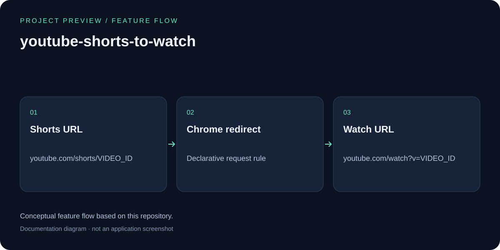

# YouTube Shorts to Watch

## Feature overview

Conceptual feature flow based on this repository; this is a documentation diagram, not an application screenshot.

A Chrome extension that automatically redirects YouTube Shorts URLs to regular YouTube watch page.

## What it does

Converts:
- `https://www.youtube.com/shorts/XU5CcUL7XJ4`

To:
- `https://www.youtube.com/watch?v=XU5CcUL7XJ4`

## Installation

1. Open Chrome and go to `chrome://extensions/`
2. Enable "Developer mode" (toggle in the top right)
3. Click "Load unpacked"
4. Select this extension folder
5. The extension is now active!

## How it works

Uses Chrome's Declarative Net Request API to intercept and redirect YouTube Shorts URLs before they load, providing a seamless experience with no page flicker.
